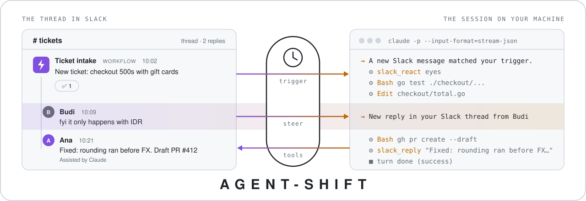
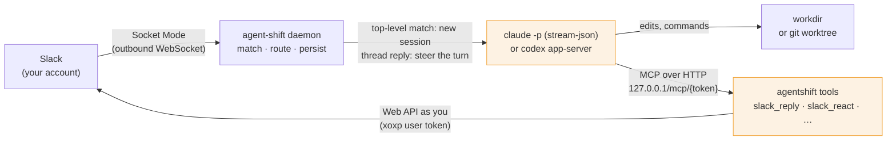

<p align="center">
  <picture>
    <source media="(prefers-color-scheme: dark)" srcset="assets/banner.svg">
    <source media="(prefers-color-scheme: light)" srcset="assets/banner-light.svg">
    
  </picture>
</p>

<p align="center">
  <b>Turn a Slack message into a Claude Code or Codex session on your own machine, and keep steering it from the thread.</b>
</p>

<p align="center">
  
  
  
  <a href="LICENSE"></a>
</p>

agent-shift is a small Go daemon that listens to **your own Slack account**. When a top-level message
matches one of your agents, it starts a Claude Code or Codex session on your computer, in the
directory you chose, with that message as the first prompt. Every later reply and reaction in the
message's thread goes into the same session, even while it is working, and the agent answers
through Slack tools that post from your account.

There is no bot user, no server and no API key. Slack events arrive over an outbound Socket Mode
WebSocket, so nothing needs a public URL. The CLIs run with their own logins, so the work counts
against your Claude or ChatGPT subscription. agent-shift itself talks only to Slack and to `127.0.0.1`.

The name: a shift is the stretch of work someone covers so you don't have to be there. agent-shift
puts an agent on shift in the conversations you choose. It takes what comes in, works on it in the
thread, and is still there when someone replies.

> **Status:** early work. macOS and Windows only (elsewhere `autostart` reports unsupported). The
> Codex side speaks `codex app-server`'s JSON-RPC protocol and was checked against codex 0.166. The
> Claude Code side reads `claude --help` and only passes the optional flags that the installed version
> lists.

---

## In 30 seconds

An agent is a trigger, a prompt, an engine and a directory:

```yaml
# ~/.agent-shift/config.yaml (written for you by `agent-shift agents add`)
agents:
  - name: ticket-triage
    engine: claude
    workdir: /Users/ana/code/payments
    worktree: true          # each session gets its own git worktree
    autonomy: full          # may push and open PRs without asking
    system_prompt: |
      Each message is a ticket. Reproduce it, fix it on a new branch, open a draft PR
      with `gh pr create --draft`, and reply in the thread with the link.
    trigger:
      workspace: T0123ABCD
      conversations: [{ id: C0456EFGH, name: tickets }]
      from: [{ id: B0789IJKL, name: Ticket intake workflow }]
```

A ticket lands in `#tickets`. A teammate adds a detail while the agent is still working. Ana is you:

```text
#tickets
  Ticket intake  WORKFLOW  10:02
  New ticket: checkout 500s with gift cards
  [✅ 1]
    ↳ Budi  10:09
      fyi it only happens with IDR
    ↳ Ana  10:21
      Fixed: rounding ran before FX. Draft PR #412
      Assisted by Claude
```

```console
$ agent-shift sessions list
k7mfa2qe  ○ idle    ticket-triage    4m ago   #tickets — New ticket: checkout 500s with gift cards
```

**What that thread means.** The workflow's message was top-level, in a conversation the trigger
lists, from a sender the trigger lists, so it started session `k7mfa2qe`. agent-shift made a detached
git worktree of `payments`, started `claude -p` there with the agent's prompt appended to Claude
Code's system prompt, and gave it the message. Budi's reply did not wait behind the running turn; it
went into the turn itself. Every post, reaction and link in the thread came from a tool call the agent
made, and agent-shift posted nothing of its own. The session is `idle` now, so its CLI process is
still alive. After `idle_timeout` (30 minutes) the process stops, and the next reply in the thread
picks up the same conversation with `claude --resume`.

## How it works



The shaded boxes act with **your authority**: the CLI runs commands on your machine, and the tools
post as you. Everything else only reads, matches or routes.

Four design decisions do most of the work:

* **You are the only identity.** The Slack app has no bot user and holds only user scopes, so the
  agent reads what you can read and writes as you. Every message it sends carries an
  `Assisted by Claude` / `Assisted by Codex` footer, a context block with the id `agentshift_footer`.
  agent-shift uses that footer, plus the messages, files and reactions each session made, to
  recognise its own output. It never feeds that output back to an agent or treats it as a trigger,
  even though it comes from your account. So an agent can't start itself or another agent.
* **agent-shift never speaks.** It posts no progress, no errors and no "thinking…". Every message,
  reaction, edit and upload is a tool call the agent chose to make, and the agent is told that nobody
  reads its plain-text output. If a turn fails, for example on a usage limit, the thread stays quiet,
  `agent-shift sessions show <id>` has the error, and the next reply retries.
* **One thread, one session, and the process can come and go.** The first enabled agent whose trigger
  matches a top-level message owns its thread. The CLI process is not the session. It stops after
  `idle_timeout`. When a new session needs one of the `max_sessions` slots, the least recently active
  idle process is stopped first. The next message brings the process back with the engine's own
  conversation id (`claude --resume`, Codex `thread/resume`). If that fails, a fresh process gets the
  thread's history from Slack.
* **Slack's history is the record of downtime.** Socket Mode only delivers events while connected, so
  each workspace keeps a watermark of how far its events were received (`state.json`). On start, on
  reconnect and on wake from sleep (a heartbeat more than 2 minutes late), agent-shift replays Slack
  history from 3 minutes before that watermark, at most `catch_up` back, oldest first. Each session
  records the message timestamps it has seen, so nothing is handled twice.

More in [SETUP.md § How a session behaves](SETUP.md#4-how-a-session-behaves).

## Stop it from the thread

There is no stop button. Every reply in the thread reaches the agent while it works: Claude Code gets
it streamed into the running turn, Codex through `turn/steer`. So stopping is steering. Write "stop",
or "hold off until Rina confirms", and the agent stops and says so in the thread. A 🛑 reaction is
read the same way: it is a reaction the agent sees, not a switch agent-shift flips. Nothing in Slack
stops a turn on its own.

From your terminal, `agent-shift sessions interrupt <id>` cuts the current turn off. The session
stays open, and the next reply in the thread continues it.

<details>
<summary>What the agent is told (from <code>internal/session/prompt.go</code>)</summary>

Its instructions say:

```text
New replies and reactions in that thread are delivered to you as new messages, even while you are working. Treat them as updates or instructions from the people involved. If someone asks you to stop or hold off (in words or with a reaction like :octagonal_sign:), stop what you are doing right away and say so in the thread.
```

A reaction is delivered as a message like this one:

```text
Ana — the person you work for (U0123ABCD) reacted with :octagonal_sign: on your message (ts 1793440601.760329): "2"
```

Replies arrive the same way, with the sender, the time and the text wrapped in `<slack_message>`
tags. A reply that was posted while agent-shift was offline is marked as such.
</details>

## Close the laptop

Nothing runs while your computer is off or asleep, and Slack gives up on Socket Mode events it
cannot deliver. In this test the daemon was stopped for three minutes. Meanwhile, a new message was posted
and someone replied in the thread of an existing session (names and paths changed):

```console
$ agent-shift logs
time=2026-11-01T11:40:02.262+07:00 level=INFO msg="shutting down"
time=2026-11-01T11:43:13.660+07:00 level=INFO msg="agent-shift daemon running" version=dev pid=23844 agents=1 workspaces=1
time=2026-11-01T11:43:14.572+07:00 level=INFO msg="connected to Slack (Socket Mode)" workspace=Acme app_id=A0123ABCD
time=2026-11-01T11:43:15.569+07:00 level=INFO msg="agent process started" session=wu2a2fq7 agent=catchup-test engine=claude engine_session=de2b0fbd-35d3-4734-b9b4-630eee0e6c79 resumed=true workdir=/Users/ana/scratch
time=2026-11-01T11:43:15.981+07:00 level=INFO msg="new session" session=dpq9thri agent=catchup-test conversation=#scratch from=Ana engine=claude title="B (posted while the daemon was offline): tell me the magic word…"
time=2026-11-01T11:43:15.981+07:00 level=INFO msg="caught up on Slack activity missed while offline" workspace=Acme offline=3m12s conversations=1 threads=1 new_sessions=1 replies=1
time=2026-11-01T11:43:16.023+07:00 level=INFO msg="agent process started" session=dpq9thri agent=catchup-test engine=claude engine_session=8b52f3ca-ef07-49b0-b736-0e001efa4460 resumed=false workdir=/Users/ana/scratch
```

The missed reply went to its thread's session, which came back with `claude --resume`
(`resumed=true`) in the same conversation. The missed top-level message started a new session. Both
happened within 2.4 s of the daemon starting. A message picked up more than two minutes late tells
the agent so before anything else:

```text
A new Slack message matched your trigger.

It was posted 40 minutes ago while agent-shift (the program relaying Slack to you) was offline —
this computer was off, asleep or disconnected — so you are picking it up late. Make sure it still
needs doing before you act.
```

If people already replied in that thread, the agent gets those replies too, oldest first. Limits:
anything older than `catch_up` (default 3 days) is skipped with a warning, the very first start
replays nothing, an agent only replays what it would have seen live (so one added while the daemon
was stopped replays nothing), and reactions made while offline are not replayed. A session that was in the middle of a turn when the
daemon stopped (less than 6 hours earlier) is told it was restarted and carries on by itself.

## What an agent can do

Every session gets its own `agentshift` MCP server, bound to that session's thread and to your
identity. Its tools are pre-approved, so they never wait for a permission prompt:

| Tool | What it does |
|---|---|
| `slack_reply` | Reply in the session's thread (optionally also to the channel) |
| `slack_send_message` | Send to `#channel`, `@person`, an email, a user or channel ID, or a group DM, optionally into a thread |
| `slack_read_thread` | Read a thread (default: the session's) |
| `slack_read_channel` | Read recent messages of a channel or DM |
| `slack_search` | Slack search (`in:#chan from:@x after:…`) |
| `slack_get_user`, `slack_find_conversations` | Look people and conversations up |
| `slack_download_file` | Save an attachment under `sessions/<id>/files/` so the agent can read it |
| `slack_upload_file` | Share a local file (default: into the thread) |
| `slack_react` | Add or remove a reaction (default: on the trigger message) |
| `slack_edit_message`, `slack_delete_message` | Only for messages this session sent |

Messages are written in standard Markdown and sent as Slack markdown blocks.

**Autonomy.** Nobody is at the keyboard, so nothing may wait for a human. Below `full`, anything that
would ask for permission is denied instead of left hanging, and the agent is told why so it can ask in
the thread. The three levels map onto each engine's own controls:

| `autonomy` | Claude Code | Codex (`thread/start`) |
|---|---|---|
| `auto` | `--permission-mode=auto`: Claude Code's own reviewer decides | `sandbox: workspace-write`, `approvalPolicy: on-request`, `approvalsReviewer: auto_review` |
| `full` | `--permission-mode=bypassPermissions` | `sandbox: danger-full-access`, `approvalPolicy: never` |
| `readonly` | `--permission-mode=default`; anything that would prompt is denied | `sandbox: read-only`, `approvalPolicy: never` |

**Worktrees.** With `worktree: true`, each session runs in its own
`git worktree add --detach … HEAD` under `~/.agent-shift/worktrees/<id>`, so several tickets can be
worked on in one repo at once. The agent is told to create a branch before committing.
`agent-shift sessions prune` removes the worktrees of ended sessions and keeps their branches.

**Workflows as senders.** `from` accepts people (`U…`), bots and Slack workflows (`B…`), apps
(`A…`) and `me`. That lets a Slack Workflow (a form, or *From a webhook*) feed tickets in.
[SETUP.md § 7](SETUP.md#7-example-tickets-from-a-slack-workflow--pull-requests) walks through
tickets turning into draft pull requests.

**Models and effort.** `agent-shift agents models` lists the models and reasoning-effort levels your
logins offer. It reads them from the CLIs themselves (Claude Code's `initialize` response, Codex's
`model/list`) without sending a prompt, so listing them uses none of your plan.

## How each engine is driven

Both engines are driven through the interfaces their own tools use, not by scraping a terminal:

| | Claude Code | Codex |
|---|---|---|
| Process | `claude -p --input-format=stream-json --output-format=stream-json`, one per session | `codex app-server`: JSON-RPC over stdio, the protocol of the Codex IDE extension |
| agent-shift's instructions | `--append-system-prompt-file`, on top of Claude Code's own prompt | `developerInstructions` |
| Slack tools | `--mcp-config` pointing at the session's loopback endpoint | an `mcp_servers` override merged with your `config.toml` |
| A message mid-turn | written to stdin and streamed into the running turn | `turn/steer` |
| `sessions interrupt` | an `interrupt` control request | `turn/interrupt` |
| Resume after idle or restart | `--resume=<session id>` | `thread/resume` |
| Slack text | sent verbatim as `client_composed` input: no slash commands, no `@file` expansion | sent as `turn/start` / `turn/steer` input |
| Environment | `ANTHROPIC_API_KEY` and `ANTHROPIC_AUTH_TOKEN` are removed unless set in `engines.claude.env`, so your subscription login is used | `CODEX_SANDBOX*` markers inherited from a Codex shell are removed |
| Process tree | macOS: a process group; Windows: a job object. Stopping a session stops everything it started | same |

Every protocol line in both directions is written to `sessions/<id>/transcript.jsonl`.
`agent-shift sessions logs <id>` summarises it, and `--raw -f` follows it live.

## What runs with your authority

| Component | What it can do | What keeps it in bounds |
|---|---|---|
| Your user token (`xoxp-…`) | Read and write in Slack as you, within the [manifest's user scopes](internal/slack/manifest.go): history of channels, private channels, DMs and group DMs; `chat:write`; reactions; files; users; `search:read`; `team:read` | Stored in the macOS Keychain or Windows Credential Manager (a `0600` `credentials.json` only when no keychain is available), never in `config.yaml`. Only the daemon and its Slack tools use it |
| App-level token (`xapp-…`) | Open the Socket Mode connection (`connections:write`) | Same store. The app has no bot user and no redirect URL |
| The engine CLI | Whatever `autonomy` allows, in `workdir` or its worktree | `autonomy`, plus the CLI's own sandbox and permission system |
| The `agentshift` MCP endpoint | Every Slack tool, bound to one session's thread | `127.0.0.1` on a random port, behind a random 192-bit token per session in the path |
| The control endpoint (CLI ↔ daemon) | Status, session list, interrupt or stop a session, reload, shut down | `127.0.0.1`, behind a bearer token from `daemon.json`, compared in constant time |

**Not involved:** any agent-shift server or cloud service, a Slack bot user, and API keys.
agent-shift connects to Slack and to `127.0.0.1`. The CLIs connect to their own providers, as they
always do.

## What a session does and does not mean

A session means one thing: a top-level message matched an agent's trigger, and from then on its
thread is wired to one CLI conversation. It says nothing about whether the agent's judgement was
good. **Read what it posts.**

| It does | It does not |
|---|---|
| Start a session for a top-level message that matches the agent's `workspace`, `conversations`, `from`, `contains` and `regex` | Start one from a thread reply, from Slackbot, from its own posts, or in a conversation you are not a member of (Slack only sends user events for those) |
| Deliver every later reply and reaction in that thread to the same session, mid-turn if it is working | Post anything on its own. Progress, errors and "on it" exist only if the agent sends them |
| Keep sessions across daemon restarts, and continue ones that were mid-task less than 6 hours earlier | Run while your computer is off. There is no server; it catches up when the computer is back |
| Replay top-level messages and thread replies missed while offline, up to `catch_up` back, each once | Replay reactions made while offline, or anything from before the very first start |
| Run at most `max_sessions` CLI processes, stopping idle ones first | Keep listening to a thread after `thread_ttl` (default 7 days) without activity |
| Let the agent edit or delete only messages that session sent | Stop the agent from messaging other people or channels as you. That is what `autonomy`, the prompt and narrow triggers are for |

## Security posture: Slack text is untrusted input

Anyone who can post in a conversation an agent watches can put text in front of a coding agent that
runs on your machine and writes as you. agent-shift assumes that text may be hostile and keeps it
where it belongs:

* **Triggers are narrow by design.** A trigger is tied to one workspace and to explicit conversation
  IDs. `from` limits who can start a session: people, bots or workflows. `contains` and `regex` filter
  further. Only top-level messages start sessions.
* **`thread_from` decides who can steer.** By default anyone in the thread can steer a session,
  including telling it to stop. With `thread_from` set ("only me", or "me and the trigger senders"), replies and reactions
  from anyone else are dropped before the agent sees them.
* **Text stays text.** Messages go to the engine verbatim, inside `<slack_message>` tags with the
  sender, conversation and time. Claude Code receives them as `client_composed` input, so a message
  starting with `/` is not a slash command and `@file` is not expanded.
* **Nobody is waiting on a human who isn't there.** Below `full`, an action that would prompt is
  denied, not queued, and the agent is told so it can ask in the thread instead.
* **Its own output never loops back.** Messages carrying the `agentshift_footer` block, and the
  messages, files and reactions each session recorded, are never delivered to an agent or matched as
  triggers.
* **Tokens stay in the keychain.** The MCP and control endpoints listen on loopback only, behind
  random tokens. `ANTHROPIC_API_KEY` is removed from the Claude environment unless you set it
  yourself.

What none of this can do is give the agent good judgement. The agent is told that it writes as a
real person, that it should message others only when the task calls for it, and that it must never
share secrets. That is an instruction, not a guarantee. Keep `autonomy`, `from` and `thread_from` as
tight as the task allows. On a machine that holds anything you care about, use a worktree and `auto`
rather than `full`.

## Quick start

**Requirements:** macOS or Windows, Go 1.26+ (to build), and
[Claude Code](https://claude.com/claude-code) and/or [Codex CLI](https://developers.openai.com/codex/cli),
installed and logged in (`claude auth login`, `codex login`). You also need a Slack workspace where you
may create and install a private app; some workspaces need an admin to approve the install.

```sh
git clone https://github.com/daffirds/agent-shift && cd agent-shift
# build into any directory on your PATH (name it agent-shift.exe on Windows)
go build -o ~/.local/bin/agent-shift ./cmd/agent-shift
agent-shift setup
```

`setup` works through four steps:

1. It checks that the CLIs are installed and logged in.
2. It opens Slack's *Create app from manifest* page, pre-filled with the user scopes agent-shift
   needs.
3. It takes the app-level token (`xapp-…`) and your user token (`xoxp-…`), checks both against
   Slack, and stores them in the keychain.
4. It walks you through your first agent and starts the daemon, optionally at login.

Then post a matching message and watch the thread.

New to agent-shift? **[SETUP.md](SETUP.md)** starts from a fresh clone and ends with a working
agent. It then covers every setting, and closes with Slack workflow tickets turning into draft pull
requests.

## Commands

| Command | Purpose |
|---|---|
| `agent-shift setup` | Guided setup: CLIs, Slack, first agent, daemon (safe to re-run) |
| `agent-shift start` · `stop` · `restart` | The background daemon (no console window on Windows). Sessions survive `stop` and resume later |
| `agent-shift run` | The daemon in the foreground with live logs |
| `agent-shift status` | Daemon, Slack connections and the last catch-up, agents, sessions by state |
| `agent-shift logs [-f]` | The daemon log |
| `agent-shift reload` | Apply `config.yaml` edits to the running daemon |
| `agent-shift agents list` · `add` · `edit` · `show` · `remove` · `enable` · `disable` | Manage agents |
| `agent-shift agents models [claude\|codex]` | Models and effort levels your CLI logins offer |
| `agent-shift slack connect` · `list` · `remove` · `manifest` · `find` | Workspaces, the app manifest, and IDs for editing the config by hand |
| `agent-shift sessions list [-a]` · `show` · `logs` · `interrupt` · `stop` · `prune` | Inspect and control sessions |
| `agent-shift autostart enable` · `disable` · `status` | A LaunchAgent on macOS, a per-user *Run* entry on Windows |
| `agent-shift doctor` | Check the CLIs and their logins, Slack tokens and scopes, the config and the daemon |

Session IDs can be shortened to any unique prefix. Commands that change the config reload a running
daemon automatically.

## Documentation

| Document | Contents |
|---|---|
| [SETUP.md](SETUP.md) | Requirements, build and install, the setup wizard and the Slack app |
| [§ 4 How a session behaves](SETUP.md#4-how-a-session-behaves) | Start, steer, stop, idle, slots, restarts, offline catch-up, expiry, errors, and the agent's tools |
| [§ 6 Configuration file](SETUP.md#6-configuration-file) | Every key of `config.yaml` |
| [§ 7 Example](SETUP.md#7-example-tickets-from-a-slack-workflow--pull-requests) | Tickets from a Slack workflow turning into draft pull requests |
| [§ 8 Files](SETUP.md#8-files) | What lives in `~/.agent-shift` |
| [§ 9 Platform notes](SETUP.md#9-platform-notes) | Windows job objects, the macOS LaunchAgent and `PATH` |
| [§ 10 Security notes](SETUP.md#10-security-notes) | The short version of the security posture above |
| [§ 11 Troubleshooting](SETUP.md#11-troubleshooting) | `doctor`, logs, "nothing happens", missing scopes, sleep |

## License

agent-shift is released under the [MIT License](LICENSE).
